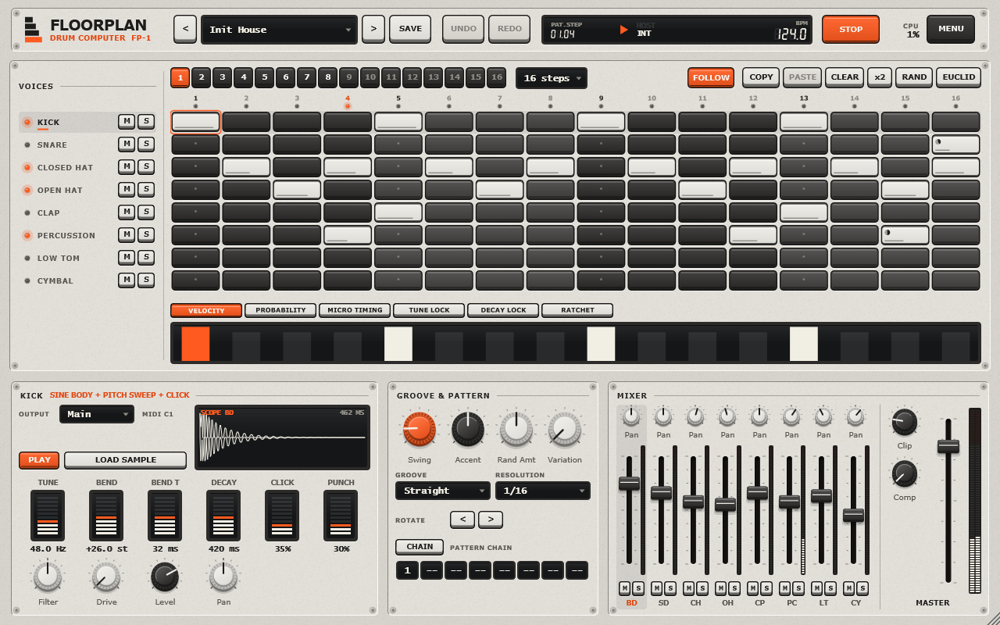

<p align="center">
  
</p>

<p align="center">
  <b>A lightweight, open-source drum machine plugin for House, Tech House, Techno and EDM.</b><br>
  Eight synthesized voices, a sample-accurate step sequencer and a hardware-style interface, at well under 1% of a CPU core.
</p>

<p align="center">
  <a href="https://github.com/Kuzuw/Floorplan/actions/workflows/ci.yml"></a>
  <a href="LICENSE"></a>
  
  
  
  
</p>

<p align="center">
  
</p>

---

## Contents

- [Highlights](#highlights)
- [Sounds](#sounds)
- [Sequencer](#sequencer)
- [Performance](#performance)
- [Building from source](#building-from-source)
- [Installing](#installing)
- [Using Floorplan](#using-floorplan)
- [Project layout](#project-layout)
- [Testing](#testing)
- [Roadmap](#roadmap)
- [Contributing](#contributing)
- [License](#license)

## Highlights

- **Works immediately.** Every voice is synthesized, so there is nothing to download or install besides the plugin. Load your own WAV/AIFF/FLAC one-shots per voice whenever you like.
- **Built for dance music.** Four-on-the-floor defaults, swing and groove templates, offbeat open hats with closed-hat choke, ratchets, flams, probability and per-step parameter locks.
- **Tight timing.** The sequencer follows the host play head with sample-accurate events, handles tempo changes, loops and transport jumps, and never uses a wall-clock timer.
- **Very light.** About 0.3% of one laptop core for a typical groove. Idle voices cost nothing, and the audio thread never allocates, locks or touches the disk.
- **Production-ready plumbing.** 155 automatable parameters, versioned project state, kit presets, a documented JSON pattern format, MIDI learn and optional per-voice outputs.
- **Hackable.** The DSP and sequencer core is plain C++17 with no JUCE dependency, so you can unit-test and benchmark it in isolation. A new voice is one table entry plus one class.

## Sounds

| Voice | Engine | Controls |
| --- | --- | --- |
| Kick | Sine body, exponential pitch sweep, hold stage, noise click | Tune, Bend, Bend Time, Decay, Click, Punch. Advanced Mode adds Attack, Shape, Sub, Click Tone and Click Length |
| Snare | Two-mode tuned shell plus high-passed noise wires | Tune, Tone, Decay, Snappy, Body, Width. Advanced Mode adds Drop, Drop Time, Ring, Wire Tone and Wire Delay |
| Closed Hat | Six band-limited square oscillators and noise, high-passed | Tune, Decay, Bright, Metal, Tone, Width |
| Open Hat | Same metallic engine, choked by the closed hat | Tune, Decay, Bright, Metal, Tone, Width |
| Clap | Band-passed noise shaped by a multi-burst envelope | Tune, Decay, Spread, Bursts, Tone, Width. Advanced Mode adds Attack, Burst Length, Tail Level and Jitter |
| Percussion | Tuned sine with pitch sweep, FM "metal" and noise transient | Tune, Bend, Bend Time, Decay, Noise, Metal |
| Low Tom | Same tuned engine, lower range | Tune, Bend, Bend Time, Decay, Noise, Metal |
| Cymbal | Metallic engine with a different partial set and long decay | Tune, Decay, Bright, Metal, Tone, Width |

Every voice also has **Level, Pan, Mute, Solo, a bipolar Filter** (low-pass to the left, high-pass to the right, bypassed at centre), **Drive**, **Output routing**, and sample **Tune/Decay** when a sample is loaded.

The **master section** has volume, a soft clipper (on by default as a safety stage), an optional one-knob bus compressor, and stereo meters. No processing adds latency.

## Sequencer

- 16 pattern slots with lengths of 8, 12, 16, 24, 32 or 64 steps, at 1/8, 1/16, 1/32, 1/8T or 1/16T resolution
- Per step: **velocity, probability, micro timing (±50%), accent, flam, ratchet (1–4), tune lock and decay lock**
- Swing (50–75%) plus groove templates: Straight, Shuffle, Laid Back, Push, Humanize, Broken
- Pattern switching is quantized to the end of the cycle, so there are no clicks or half patterns. An eight-slot **pattern chain** is also available.
- Copy, paste, clear, duplicate (double length), rotate, **Euclidean generator** and musical **randomization** with adjustable intensity, per track
- Undo/redo (128 levels) for every pattern edit
- Probability uses a deterministic, seedable hash, so a bounce renders exactly what you heard
- Optional **MIDI output** of the sequence (channel 10) to drive other instruments
- Eight factory grooves: House Classic, Deep House, Tech House Roll, Minimal Groove, Peak Techno, UK Garage 2-Step, Electro Breaks, Afro Perc, plus a 32-step roller

## Performance

Measured with `floorplan_bench` (sequencer + engine, single thread, Release build) on an Intel Core i7-9750H @ 2.6 GHz, Windows 11, MSVC 19.50:

| Scenario | Rate | Block | Time per block | Load on one core |
| --- | ---: | ---: | ---: | ---: |
| Idle (transport stopped) | 48 kHz | 128 | 1.3 µs | 0.05% |
| Typical house groove | 48 kHz | 128 | 8.6 µs | 0.32% |
| Typical house groove | 44.1 kHz | 512 | 34.4 µs | 0.30% |
| Worst case: all 8 voices on every 1/32 step, ratchets, max decays, drive, filters, comp, clip | 48 kHz | 128 | 52.8 µs | 1.98% |
| Same worst case | 96 kHz | 256 | 97.2 µs | 3.64% |

Numbers vary by a few percent between runs. The engine's static state is about 2 KB, plus 3 × 64 KB for the lock-free pattern buffers. The Standalone app, including GUI and audio device, runs at about 87 MB working set. Run the benchmark on your own machine with `build/Benchmarks/Release/floorplan_bench`.

## Building from source

### Requirements

| | Windows | macOS |
| --- | --- | --- |
| Compiler | Visual Studio 2022/2026 (MSVC) | Xcode 14+ (Apple Clang) |
| Build tools | CMake ≥ 3.22 (the copy bundled with Visual Studio works) | CMake ≥ 3.22 |

JUCE 8 is included as a git submodule, so there is nothing else to install.

Linux is not supported for now. Version 0.1.0 built there, but CI no longer builds or tests Linux, so later versions may not work. If you want to try anyway, JUCE needs these packages on Debian/Ubuntu:

```bash
sudo apt install libasound2-dev libjack-jackd2-dev libfreetype-dev libfontconfig1-dev libx11-dev libxcomposite-dev libxcursor-dev libxext-dev libxinerama-dev libxrandr-dev libxrender-dev libgl1-mesa-dev
```

### Build

```bash
git clone --recurse-submodules https://github.com/Kuzuw/Floorplan.git
```

```bash
cd Floorplan
```

```bash
cmake -S . -B build -DCMAKE_BUILD_TYPE=Release
```

```bash
cmake --build build --config Release --parallel
```

Artifacts end up in `build/Floorplan_artefacts/Release/`:

- `VST3/Floorplan.vst3`
- `Standalone/Floorplan` (`.exe` / `.app`)

CMake options:

| Option | Default | Purpose |
| --- | --- | --- |
| `FLOORPLAN_BUILD_PLUGIN` | `ON` | Build the JUCE plugin. Set it to `OFF` to build only the dependency-free core, tests and benchmark. |
| `FLOORPLAN_BUILD_TESTS` | `ON` | Unit tests (CTest) |
| `FLOORPLAN_BUILD_BENCHMARKS` | `ON` | `floorplan_bench` |
| `FLOORPLAN_JUCE_DIR` | `external/JUCE` | Use a different JUCE checkout |

## Installing

Download the installer for your system from the [Releases](https://github.com/Kuzuw/Floorplan/releases) page, run it, then rescan plugins in your DAW.

| Platform | Installer | Installs to |
| --- | --- | --- |
| Windows 10/11 (64-bit) | `Floorplan-<version>-Windows-x64-Setup.exe` | VST3: `C:\Program Files\Common Files\VST3\`<br>App: `C:\Program Files\Floorplan\` |
| macOS 11+ (Apple silicon and Intel) | `Floorplan-<version>-macOS.pkg` | VST3: `/Library/Audio/Plug-Ins/VST3/`<br>App: `/Applications/` |

Both installers let you choose the VST3 plugin, the Standalone app, or both. On Windows, uninstall from *Settings → Apps*.

If you only want the plugin, each release also has a `…-VST3.zip` per platform: unzip it and copy `Floorplan.vst3` to your VST3 folder (see [Manual installation](#manual-installation)).

Nothing is code-signed yet, so you will see a warning:

- **Windows:** SmartScreen says "Windows protected your PC". Click **More info**, then **Run anyway**.
- **macOS installer:** the package is blocked as coming from an unidentified developer. Open **System Settings → Privacy & Security**, click **Open Anyway** next to the Floorplan message, then open the package again.
- **macOS zip:** before copying, remove the download quarantine in Terminal with `xattr -dr com.apple.quarantine Floorplan.vst3`. Otherwise your DAW may refuse to load the plugin.

### Manual installation

To install from a zip or a build of your own, copy `Floorplan.vst3` to your VST3 folder:

| OS | Folder |
| --- | --- |
| Windows | `C:\Program Files\Common Files\VST3\` |
| macOS | `/Library/Audio/Plug-Ins/VST3/` or `~/Library/Audio/Plug-Ins/VST3/` |

The Standalone app runs from anywhere. Pick your audio/MIDI device under *Options → Audio/MIDI Settings*.

To build the installers yourself after a Release build: on Windows, `iscc /DAppVersion=<version> packaging\windows\Floorplan.iss` ([Inno Setup 6](https://jrsoftware.org/isinfo.php)); on macOS, `packaging/macos/build-pkg.sh <version>`. Both write to `dist/`.

## Using Floorplan

### Workflow

1. Pick an instrument on the left, or press `A S D F G H J K` to play the eight voices from your computer keyboard.
2. Click or drag in the grid to place hits. Shift-click adds an accent, the mouse wheel sets velocity, and right-click opens the step menu (ratchet, flam, probability, locks).
3. Below the grid, the **lane** edits velocity, probability, micro timing, tune lock, decay lock or ratchet for the selected track. Drag to draw, double-click to reset.
4. Shape the sound in the **sound panel**. The waveform preview is rendered by the real voice DSP; click it to audition.
5. Add swing, choose a groove template, chain patterns, and mix with the faders.

In a DAW, Floorplan follows the host transport. Without one (the Standalone app, or a stopped host) press **PLAY** or `Space` to run the internal clock at the tempo shown in the header.

### Shortcuts

| Keys | Action |
| --- | --- |
| `A` … `K` | Trigger voices 1–8 (`Shift` = full velocity) |
| `Space` | Start/stop the internal transport |
| Arrow keys / `Enter` | Move the step cursor / toggle the step |
| `Ctrl/Cmd+Z`, `Ctrl/Cmd+Y` | Undo / redo pattern edits |
| `Ctrl/Cmd+C`, `Ctrl/Cmd+V` | Copy / paste the pattern |
| Double-click a knob | Reset to default |
| Right-click a knob | MIDI learn / clear CC / reset |

### MIDI

Default note map (General MIDI drums). Change any of them with *right-click instrument → Learn MIDI note*.

| Voice | Note | | Voice | Note |
| --- | --- | --- | --- | --- |
| Kick | C1 (36) | | Clap | D#1 (39) |
| Snare | D1 (38) | | Percussion | C#1 (37) |
| Closed Hat | F#1 (42) | | Low Tom | F1 (41) |
| Open Hat | A#1 (46) | | Cymbal | C#2 (49) |

Any knob can be mapped to a MIDI CC with right-click → *MIDI Learn*. Mappings are saved with the project.

### Samples, kits, patterns

- **Samples:** drag a WAV/AIFF/FLAC/Ogg file onto an instrument, or use *Load sample* in the sound panel. Projects store only the file path, never the audio. A missing file is flagged and the voice falls back to synthesis.
- **Kits** (sound presets) live in `Documents/Floorplan/Kits/*.fpkit`. Kits never touch your patterns.
- **Patterns** export and import as JSON (`.fppattern`, `.fpbank`). See the [pattern format](docs/PATTERN_FORMAT.md).
- **Multi-out:** pick *Out 2–9* in a voice's OUTPUT box and enable the matching output bus in your DAW. If that bus is disabled, the voice plays through the main mix.

## Project layout

```
Source/
  DSP/          SineTable, SVF/one-pole filters, PolyBLEP oscillator, soft clip, bus compressor
  Instruments/  DrumVoice base + Kick, Snare, Clap, Metal, Tone and Sample voices
  Sequencer/    Pattern model, Euclid/randomize/rotate, sample-accurate Sequencer
  Audio/        DrumEngine (strips, routing, master), TripleBuffer
  Parameters/   ParameterSpecs (single source of truth), JUCE layout, audio-thread cache
  Presets/      PatternStore (undo + lock-free hand-off), JSON serializer, kits, factory content, sample loader
  UI/           LookAndFeel and components
  PluginProcessor / PluginEditor
Tests/          Core tests (no JUCE) and plugin tests (processor, state, presets)
Benchmarks/     floorplan_bench
docs/           Architecture, pattern format, DAW test plan, roadmap, dev log
packaging/      Windows installer (Inno Setup) and macOS installer package scripts
```

How the pieces fit, the threading model and how to add a voice are in **[docs/ARCHITECTURE.md](docs/ARCHITECTURE.md)**.

## Testing

```bash
ctest --test-dir build -C Release --output-on-failure
```

There are 43 automated tests. They cover oscillator and envelope accuracy, every voice's output (finite, audible, decays to silence), parameter bounds, extreme settings and random fuzzing (no NaN/Inf), sample-accurate step timing, block-size invariance, swing, micro timing, probability statistics and determinism, ratchets and flams, host loops, start/stop mid-pattern, tempo changes, pattern switching and chaining, the triple buffer under concurrency, state save/restore, legacy state migration, JSON import robustness, factory kits, bus layouts and automation.

DAW compatibility has **not** been verified by the maintainers yet. [docs/DAW_TESTING.md](docs/DAW_TESTING.md) has a step-by-step checklist; reports from different hosts are very welcome.

## Roadmap

Done in 0.1: everything above. Next up:

- [ ] Verified test passes in Reaper, Ableton Live, Bitwig, FL Studio and Logic (via AU)
- [ ] AU and CLAP formats
- [ ] Per-track pattern length (polymeter)
- [ ] More lockable parameters per step (filter, drive, pan)
- [ ] Per-voice sample start, reverse and layering of sample + synthesis
- [ ] Song mode / scenes

See [docs/ROADMAP.md](docs/ROADMAP.md) for the full list.

## Contributing

Bug reports, sound-design tweaks, factory patterns and code are all welcome. Please read [CONTRIBUTING.md](CONTRIBUTING.md) and the [Code of Conduct](CODE_OF_CONDUCT.md) before opening a pull request.

## License

Floorplan is free software, licensed under the **GNU General Public License v3.0 or later**. See [LICENSE](LICENSE).

Floorplan is built with [JUCE](https://juce.com), which is used under the **AGPLv3** (JUCE 8's open-source option). Binaries that include JUCE are therefore covered by the AGPLv3's terms as well. GPLv3 section 13 explicitly allows this combination. Third-party components and their licenses are listed in [THIRD_PARTY_NOTICES.md](THIRD_PARTY_NOTICES.md).

VST is a registered trademark of Steinberg Media Technologies GmbH.
